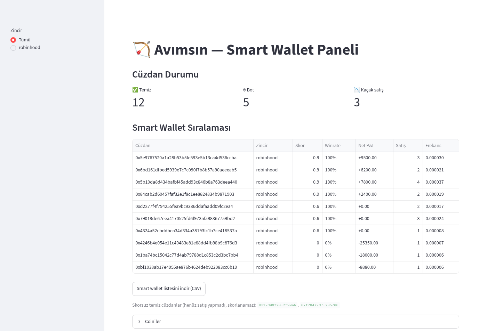
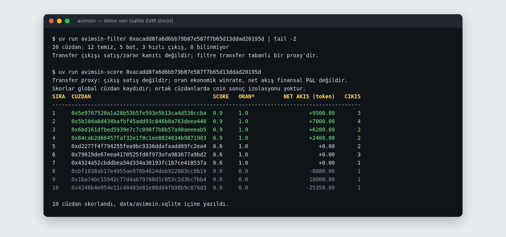

# Avımsın (avimsin) 🏹

[](https://github.com/haybinalim/avimsin/actions/workflows/ci.yml)
[](pyproject.toml)
[](LICENSE)
[](https://github.com/astral-sh/ruff)

> **EN:** Avımsın finds the wallets that bought a coin early, filters out bots and panic sellers, ranks the remaining smart-money wallets by performance and sends a Telegram alert when they buy together above your threshold. Python · on-chain analytics.

**Smart wallet bulucu ve takipçi.** Bir coin'i erken alan cüzdanları bulur, bot
cüzdanlarını ve kağıt-elyaf (panik satan) cüzdanları eler, kalan **smart wallet**
listesini performansa göre sıralar ve belirlediğiniz eşikte toplu alım olduğunda
Telegram'dan haber verir.

> Repo adı `avimsin` — GitHub Türkçe karakter desteklemediği için; proje adı **Avımsın**.

## Ekran Görüntüleri / Screenshots

> Görüntüler **sahte demo verisiyle** alınmıştır: testlerdeki sahte EVM zinciri
> (`tests/fake_evm.py`) üzerinde gerçek `scan → filter → score` CLI'ları çalıştırıldı;
> adresler ve miktarlar uydurmadır, gerçek cüzdan veya RPC verisi değildir.
> *EN: Captured with fake demo data (the test suite's fake EVM chain) — not real wallets.*

**Streamlit paneli** — cüzdan durumu (temiz / bot / kaçak satış) ve smart wallet sıralaması:



**CLI** — `avimsin-filter` özeti ve `avimsin-score` sıralama tablosu:



## Mevcut doğruluk sınırı

Bu sürüm transfer tabanlı bir göstergedir: token girişi doğrulanmış satın alma,
token çıkışı satış değildir. Dump kuralı ilk geçerli girişten başlayan pencerede
pozitif çıkış/giriş **miktarını** karşılaştırır; fiyat ve zarar koşulu henüz yoktur.
Skorun oranı ekonomik winrate, net token akışı finansal P&L değildir. Gerçek swap
ve maliyet modeli eksiktir.

**Karar ve skor coin bazlıdır:** `coin_verdicts(coin, wallet, ...)` ve
`coin_scores(coin, wallet, ...)` tabloları. `avimsin-filter <coin>` ve
`avimsin-score <coin>` yalnız o coin'in satırlarını yazar/yeniler; başka coin'deki
sonuçlara dokunmaz. Eski `wallets.verdict*` kolonları ve `scores` tablosu silinmedi
ama artık yazılmaz ve okunmaz; eski global kayıtların coin bilgisi yoktur, taşınmaz.
Eski bir veritabanında yeni tablolar boşken CLI ve panel bunu belirten bir not
gösterir: `avimsin-filter` ve `avimsin-score`'u her coin için yeniden çalıştırın.

`score` uygunluğu o coin'in `coin_verdicts` kaydından (`verdict=ok`) okur; yeniden
çalıştırma yalnız bu coin'in skorlarını atomik yeniler (çıktısız/uygunsuz olanları
kaldırır). Uygun olmayan bir karar yalnız o coin'in skorunu siler.
Boş filtre geçmişi temiz sayılmaz. CLI token birimi gösterir; DB'deki net akış
tam tokene yuvarlanır, panel hassasiyeti bu aşamada düzeltilmiş değildir.

`watch` yalnız seçilen zincirin açıkça etiketli coinlerini izler. Smart wallet: seçili zincirde en az bir coin'de `verdict=ok`
olan ve o zincirin hiçbir coin'inde `verdict=bot` olmayan cüzdan (dump coin'e özgüdür,
tek başına dışlamaz; zinciri NULL coinler sayılmaz). Küme boşsa log'a uyarı yazılır
(ilk turda ve dolu→boş geçişinde). Mint/burn,
sıfır/negatif ve öz-transferler sayılmaz. Cursor kalıcıdır (`watch_cursor`):
yeniden başlatmada kesinti taranır; `WATCH_MAX_SLOTS_PER_POLL` aşılırsa aralık
atlanır (log satırı) ve cursor güncele çekilir. Eşik, son
`WATCH_SIGNAL_WINDOW_SECONDS` (varsayılan 3600) içindeki farklı cüzdan sayısıyla
turlar arası birikerek değerlendirilir; süre blok sayısına zincir aralığıyla çevrilir.
Aynı küme tekrar bildirilmez; yeni cüzdan katılırsa "güncelleme" gider; ilk tam sinyalden
`WATCH_ALERT_COOLDOWN_SECONDS` (86400) sonra coin sıfırlanır (güncellemeler süreyi uzatmaz). Telegram hatası döngüyü
düşürmez: log satırı yazılır, sinyal sonraki turda yeniden denenir. Sınırlar: gönderim
sinyal penceresinden uzun süre başarısız kalırsa sinyal düşer; bu tablolar ayrık olarak
zincire göre tutulur, transferler yine doğrulanmış alım değildir.
RPC hatası (retry bütçesi bitince) döngüyü düşürmez: log satırına yalnız sınıf adı/durum
kodu yazılır (URL/anahtar yok), tur hepsi-ya-hiç iptal edilir (cursor ilerlemez, hiçbir giriş
yazılmaz), bekleyen sinyaller yine gönderilir. `--once` modunda RPC hatası çıkış kodu 1 verir.
Açılışta ilk `block_number` hatası süreci düşürür (systemd yeniden başlatır).

## Vizyon

Önce Solana, sonra Robinhood ve diğer EVM ağları. Örnek senaryo: popüler bir ağda (önce Solana; sonra örn. Robinhood Chain) bir meme coin çok yükselir.
Avımsın o coini **ilk alan 50 cüzdanı** bulur; içinden:

- **Botları** tespit edip listeden çıkarır,
- Aldıktan sonra **zarardayken yarısından fazlasını satanları** listeden çıkarır,
- Zamanla ekleyeceğiniz kurallarla listeyi temiz tutar.

Kalan smart wallet'lar; **trade sayısı, kazanma oranı, kazanma miktarı ve işlem
sıklığı** gibi kategorilerde sıralanır. Bu cüzdanlardan **en az N tanesi** (sizin
belirleyeceğiniz eşik, ör. 3 veya 5) bir coin aldığında **Telegram bildirimi** gelir.

## Yol Haritası

| Faz | İçerik | Durum |
|-----|--------|-------|
| 0 | Repo kurulumu, Python ortamı, mimari iskelet | ✅ |
| 1 | Veri katmanı: erken alıcılar + transfer/swap geçmişi (Solana öncelikli; Robinhood Chain/EVM RPC desteği korunur) | ✅ (erken alıcılar; swap geçmişi Faz 2'de) |
| 2 | Filtre motoru: bot tespiti, kaçak satış kuralları (büyüyebilir kural seti) | ✅ (fiyat-bağımsız kurallar; P&L bazlı zenginleştirme Faz 3'te) |
| 3 | Skorlama & sıralama: kazanma oranı, P&L, işlem sıklığı | ✅ (fiyat-bağımsız; USD P&L Faz 4+ta) |
| 4 | Streamlit paneli: smart wallet listesini tarayıcıda görüntüleme | ✅ (`uv run streamlit run dashboard/app.py`) |
| 6 | Oracle Free VPS'e 7/24 dağıtım (systemd) + önce Solana, sonra Robinhood ve diğer EVM ağları | ⏳ (VPS paketi: `deploy/` — kurulum `deploy/README.md`; varsayılan zincir Solana, EVM: `--chain robinhood`) |

## Mimari

```
src/avimsin/
├── chains/          # Ağ adaptörleri (evm_base.py, robinhood.py, ... solana.py)
├── collectors/      # Veri toplama: alıcılar, transferler, swap'lar
├── filters/         # Kurallar: bot tespiti, kaçak satış ... (büyüyebilir)
├── scoring/         # Skorlama: winrate, P&L, frekans
├── alerts/          # Telegram bildirimleri (eşik bazlı)
├── storage/         # SQLite kalıcılık
└── config.py        # .env'den ayar okuma
dashboard/           # Streamlit paneli (Faz 4)
data/                # SQLite veritabanı (git'e girmez)
```

**Yeni ağ eklemek** = `chains/` klasörüne yeni bir adaptör dosyası eklemek.
Kod ağ-bağımsız yazılır; EVM ağları ve Solana aynı arayüzü kullanır.

## Kurulum (geliştirici makinesi)

```bash
cd ~/Projects/avimsin
uv sync                # Python 3.12 sanal ortamını kurar, bağımlılıkları yükler
uv run avimsin-rpc     # RPC uçlarını sıralı ölçer; aynı ağ içinde karşılaştırır
uv run avimsin-scan <mint> --from-block <slot>   # Solana (varsayılan): erken alıcıları topla
uv run avimsin-filter <mint>    # alıcıları bot/kaçak satış kurallarından geçir
uv run avimsin-score <mint>     # temiz cüzdanları winrate/P&L/frekans ile sırala
uv run avimsin-watch            # sinyal izleyici (Telegram'a bildirir; varsayılan solana)
uv run avimsin-scan 0x<kontrat> --chain robinhood --from-block <blok>   # EVM örneği
uv run pytest                 # test ağı (sahte EVM/Solana zincirleri, ağ yok)
```

`scan/filter/score/watch` komutları `--chain robinhood|solana` bayrağıyla zincir
seçer (varsayılan: kayıtlı zincir, yoksa `solana`; `watch` için `solana`); Solana ucu `.env`'de `RPC_SOLANA_*` ile verilir,
verilmezse public devnet ucu kullanılır.

`0x` EVM adresi `--chain robinhood` olmadan verilirse (ya da base58 adres
`robinhood` ile) RPC sorgusundan önce net hata verilir. Kayıtlı zincir ile `--chain` uyuşmazsa scan/filter/score RPC sorgusundan önce
durur. Zinciri bilinmeyen eski kayıtlarda `--chain` açıkça verilmelidir;
başarılı işlemde kayıt tamamlanır. Watch bilinmeyen zincirli coinleri atlar.

## RPC Stratejisi

`avimsin-rpc`, `.env` içindeki tüm `RPC_<AD>` uçlarını **sıralı** yoklar;
paylaşılan public RPC kotası için paralel istek göndermez. `RPC_SOLANA*`
adları Solana `getGenesisHash`/`getSlot`, diğer adlar (eski `RPC_ALCHEMY`,
`RPC_QUICKNODE` dahil) EVM `eth_chainId`/`eth_blockNumber` ile ölçülür.
Tablolar protokol ve ağ kimliğine (genesis hash / chain ID) göre ayrılır.
En hızlı uç ve 2 blok/slot üzerindeki gerilik yalnız **aynı ağ içinde**
raporlanır; ölçülen gecikme iki çağrının toplamıdır, tek seferlik bir gözlemdir.

Komut yalnız raporlar: **otomatik en-hızlı seçimi veya failover yoktur**.
`scan/filter/score/watch` adaptörleri, ayar adları alfabetik sıralandığında
seçilen zincirin `robinhood` veya `solana` önekiyle eşleşen **ilk** ucu kullanır.
Eşleşme yoksa Robinhood public mainnet, Solana public devnet kullanılır.
Örneğin `RPC_SOLANA_A_MAINNET`, `RPC_SOLANA_Z_BACKUP`'tan önce seçilir;
ikinci uç otomatik yedek değildir. `RPC_ALCHEMY` gibi genel adlar kontrol
komutunda ölçülür ama bu adaptörler tarafından seçilmez. Bir sağlayıcıyı
kullanmak için doğru ağa ait URL'yi `RPC_ROBINHOOD_ALCHEMY` veya
`RPC_SOLANA_HELIUS` gibi zincir önekli bir adla tanımlayın; seçimi değiştirmek
için eşleşen ayarları düzenleyin. Üretimde Solana devnet yerine mainnet
ucunu açıkça yapılandırın.

Solana istemcisi normal çağrılar ve tüm retry isteklerinde aynı asgari aralığı
uygular. 429 için 8 ek deneme; transport/502/503/504 için toplam 3 hata bütçesi
vardır. Hata türü değişince bütçeler sıfırlanmaz. Pacing paylaşılan kotanın hiç
dolmayacağını garanti etmez; tükenen bütçe açık hata üretir.

`getTransaction` legacy/v0/v1 için `maxSupportedTransactionVersion=1` ister
([resmî sözleşme](https://solana.com/developers/cookbook/transactions/versions)).
`tests/fixtures/solana_v1.json`, mainnet slot 447606860'tan gerçek JSON-parsed
yanıttır: aynı imza max=0 ile -32015, max=1 ile başarı vermiştir. Fixture testi
token hareketini çözümler; bu, bütün Solana geçmişinin eksiksiz tarandığı veya
gerçek ekonomik P&L hesaplandığı iddiası değildir.

## Geliştirme Akışı

`main` branch'i korunur; doğrudan push kapalıdır. Her değişiklik:

```bash
git switch -c feat/yeni-ozellik   # 1. feature branch
# ... geliştir, commit'le ...
git push -u origin feat/yeni-ozellik
gh pr create                      # Pull Request aç
gh pr merge --squash --delete-branch
```

## Lisans / License

[MIT](LICENSE) © haybinalim
